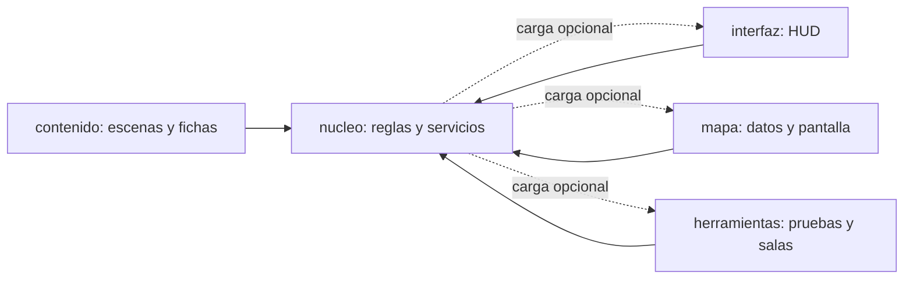
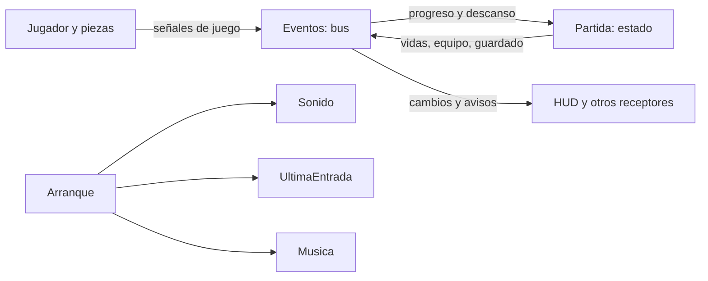
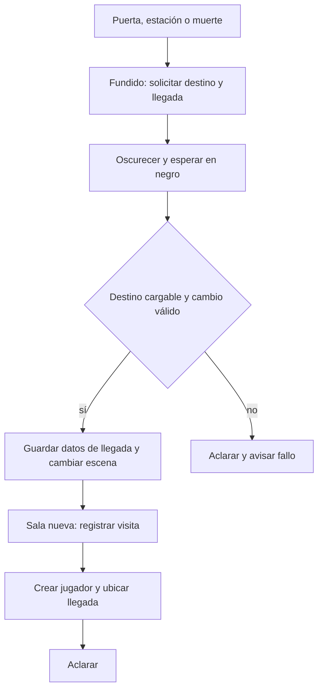
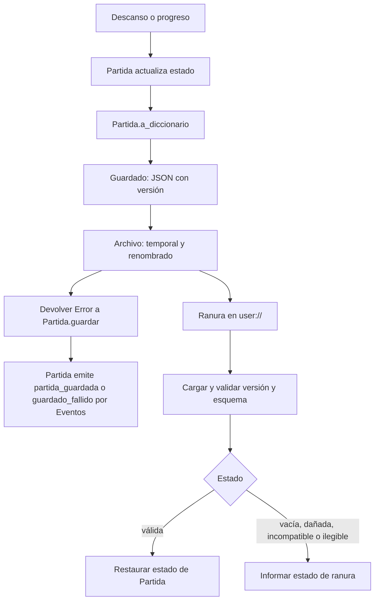

# Arquitectura

El proyecto es un juego 2D de Godot. La escena inicial es `nucleo/menu.tscn`; `project.godot` declara los autoloads `Eventos`, `Partida` y `Arranque` y el renderizador de compatibilidad.

## Bloques y dependencias

- `nucleo/`: jugador, físicas, piezas de sala, menús, estado de partida, persistencia, audio y servicios compartidos (`nucleo/jugador.gd`, `nucleo/sala.gd`, `nucleo/partida.gd`, `nucleo/guardado.gd`).
- `contenido/`: escenas y fichas concretas del juego; por ejemplo, las salas de La Celda y el catálogo de equipo (`contenido/salas/celda/celda_1.tscn`, `contenido/zonas/celda/zona_celda.tres`, `contenido/equipo.tres`).
- `interfaz/`: escena y HUD de vidas, Inspiración, monedas y avisos (`interfaz/interfaz.tscn`, `interfaz/hud.gd`).
- `mapa/`: índice de salas, datos, lienzo y pantalla del mapa (`mapa/indice_salas.tres`, `mapa/datos_mapa.gd`, `mapa/lienzo_mapa.gd`, `mapa/pantalla_mapa.gd`).
- `herramientas/`: validación, pruebas y zona jugable de pruebas (`herramientas/validar.ps1`, `herramientas/pruebas/`, `herramientas/salas/zona_pruebas.tscn`).

Las flechas indican uso o dependencia; las cargas opcionales se comprueban en ejecución (`nucleo/sala.gd`, `nucleo/cargar.gd`, `nucleo/menu.gd`, `nucleo/arranque.gd`).

## Autoloads, señales y arranque

`Eventos` declara señales compartidas: quien emite no necesita conocer a sus receptores. `Partida` mantiene el estado de la sesión y escucha eventos de progreso; el HUD escucha cambios de vidas, Inspiración y monedas (`nucleo/eventos.gd`, `nucleo/partida.gd`, `interfaz/hud.gd`).

`Arranque._ready()` carga ajustes, configura la vista y crea los servicios persistentes `UltimaEntrada`, `Sonido` y `Musica`. El puerto de depuración se carga solo en una compilación de depuración y si existe (`nucleo/arranque.gd`). El menú permite elegir ranura, crear o continuar partida; antes de iniciar respalda una partida válida (`nucleo/menu.gd`, `nucleo/ranuras.gd`). La sala instancia al jugador y monta controles, pausa, fundido y, si están disponibles, interfaz y mapa (`nucleo/sala.gd`).

Referencias de señales y conexiones: `nucleo/eventos.gd`, `nucleo/partida.gd`, `interfaz/hud.gd`, `nucleo/arranque.gd`.

## Cambio de sala

Una puerta solicita el cambio a `Fundido`; también existen perfiles de estación y muerte. La ruta se resuelve a partir del ID de sala y primero se busca en contenido. La llegada se transmite mediante variables estáticas de `Sala`, que la nueva sala consume; si falla la carga, se aclara la pantalla y se notifica el fallo (`nucleo/puerta.gd`, `nucleo/fundido.gd`, `nucleo/sala.gd`).

La muerte durante una transición con jugador puede cancelar ese cambio antes de llegar al negro (`nucleo/fundido.gd`). Véase `docs/sala.md` para el contrato de entradas, puertas, bancos y cámara.

## Guardado

El descanso actualiza el banco y emite `descanso_en_banco` antes de guardar, para que los receptores actualicen el estado. También hay autoguardados al producirse ciertos progresos (`nucleo/banco.gd`, `nucleo/partida.gd`). `Partida` serializa su estado; `Guardado` lo envuelve en JSON versionado y `Archivo` escribe mediante un temporal y renombrado (`nucleo/partida.gd`, `nucleo/guardado.gd`, `nucleo/archivo.gd`).

Hay cuatro ranuras y una copia de respaldo por ranura. La versión actual se comprueba al cargar; los campos nuevos admitidos se completan con valores por omisión. La carga distingue ranura sin archivo, partida válida, archivo dañado, versión incompatible y archivo ilegible (`nucleo/guardado.gd`, `nucleo/ranuras.gd`). La partida guarda, entre otros datos, banco, equipo, habilidades, monedas, mochila, mapas y estado por sala (`nucleo/partida.gd`).

## Contenido como datos

Las fichas son recursos con propiedades exportadas: `FichaEnemigo`, `FichaAmuleto`, `FichaUtil` y `FichaZona` definen datos que usan las piezas del núcleo (`nucleo/ficha_enemigo.gd`, `nucleo/ficha_amuleto.gd`, `nucleo/ficha_util.gd`, `nucleo/ficha_zona.gd`). Las escenas concretas combinan esas piezas y recursos; los IDs estables identifican el progreso persistente (`contenido/equipo.tres`, `contenido/salas/celda/celda_1.tscn`, `nucleo/partida.gd`). Para ampliar contenido, consultar `docs/guias/armar-una-sala.md`, `docs/guias/agregar-un-enemigo.md` y `docs/guias/agregar-un-amuleto-o-un-util.md`.

## Paquete de publicación

El preset Android `Publicacion` exporta recursos, incluye `.mp4` y excluye `.ogv`, las pruebas de código, el validador, generadores, el puerto de depuración y los archivos `funciones.json` según sus filtros. `herramientas/salas/`, incluida la zona de pruebas, no está excluida; su acceso en el menú depende del modo desarrollador (`export_presets.cfg`, `nucleo/menu.gd`). Los guiones de prueba no son recursos exportados (`docs/contrato.md`, «Paquete de publicación»). La lista exacta de filtros está en `export_presets.cfg`.
